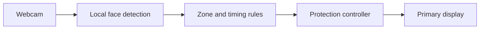

# Red-Handed

**A Windows desktop app that covers sensitive content when someone looks over your shoulder.**

In a library or shared office, someone can walk into view while you have a private document open. Red-Handed uses your webcam to detect an additional face in a zone you draw, then covers your primary display if that face stays in the zone. When the zone clears, the app restores the display after a configurable delay. You can also trigger protection yourself with **Ctrl+Alt+P**.

**Team project · NTU SC2006 Software Engineering · 64-bit Windows 10 and 11**

## See it in action

1. Start monitoring and draw a privacy zone in the webcam preview.
2. Select **Privacy Overlay**, save it, and click **Test Protection (5 seconds)** to preview the effect.
3. With monitoring on, have a second person step into the saved zone. The overlay appears after the activation delay and clears after the person leaves and the recovery delay elapses.
4. Press **Ctrl+Alt+P** to toggle manual protection, including when monitoring is off or the camera is unavailable.

The [demo checklist](docs/demo_checklist.md) includes a repeatable walkthrough using synthetic detections. It lets you demonstrate protection behavior without relying on live webcam detection.

## What it can do

| Feature | What you control |
| --- | --- |
| Privacy zone | Draw the part of the camera view where an additional face should trigger protection. |
| Three protection modes | Show an opaque privacy overlay, black out the primary display, or open a local decoy page in Chrome. The overlay covers the display while the decoy starts or if it is unavailable. |
| Protected applications | Optionally limit automatic protection to selected foreground Windows executables. The manual shortcut remains available. |
| Activation and recovery | Set how long someone must remain in the zone before protection begins and how long the zone must remain clear before protection lifts. |
| Event history | Review timestamped protection events saved locally. History contains event metadata only. |

## How it works



OpenCV captures webcam frames and a background worker runs MediaPipe face detection. The app treats the largest face as the primary user and checks whether another face's centre falls inside the saved zone. Activation and recovery delays prevent brief movements from repeatedly toggling the display.

Automatic protection and the manual shortcut create independent requests. If both are active, the display stays covered until both clear. This lets someone stop monitoring while keeping the manual cover in place.

**Built with** Python, Tkinter, OpenCV, MediaPipe, Pillow, Selenium, and Windows APIs for the global shortcut and foreground application detection.

## My contribution

I co-developed Red-Handed as part of the SC2006 team. I contributed to webcam detection and the privacy overlay, and helped build the controls for choosing which apps trigger automatic protection and activating protection manually with a keyboard shortcut.

## Run it locally

Use 64-bit Windows 10 or 11, Python 3, and a webcam for live monitoring. The team validated the automated suites on Windows 11 with Python 3.13.6. **Decoy Website** also requires Google Chrome.

From the repository root in PowerShell:

```powershell
py -3 -m venv .venv
.\.venv\Scripts\python.exe -m pip install -r requirements.txt
.\.venv\Scripts\python.exe run_red_handed.py
```

You can also double-click [launch_red_handed.bat](launch_red_handed.bat) after installing dependencies. On the Home screen, choose **Guide me through setup**.

## Validation and limitations

The [final handoff report](docs/final_report.md) records **50 unit tests and 56 integration tests passed**, including controlled scenarios for automatic activation and recovery, and continued manual protection after camera failure. Live detection accuracy, physical display coverage, and shortcut latency remained open checks.

- **Detection.** The app uses face size as a heuristic and does not identify people. Lighting, occlusion, and camera placement can affect detection.
- **Display protection.** Protection covers the primary display. It does not lock Windows. The decoy is a maximised browser window.
- **Privacy.** Camera frames are processed locally and excluded from event history. Settings and event metadata are stored under `%LOCALAPPDATA%\Red-Handed`. MediaPipe can send usage and performance telemetry. Chrome or Selenium setup may require network access.

Run the automated suites from the repository root:

```powershell
$env:PYTHONPATH = (Resolve-Path .\src).Path
.\.venv\Scripts\python.exe -B -m unittest discover -s tests/unit -v
.\.venv\Scripts\python.exe -B -m unittest discover -s tests/integration -v
```

[Application source](src/red_handed/) · [Tests](tests/) · [Requirements and evidence](docs/traceability.md)
